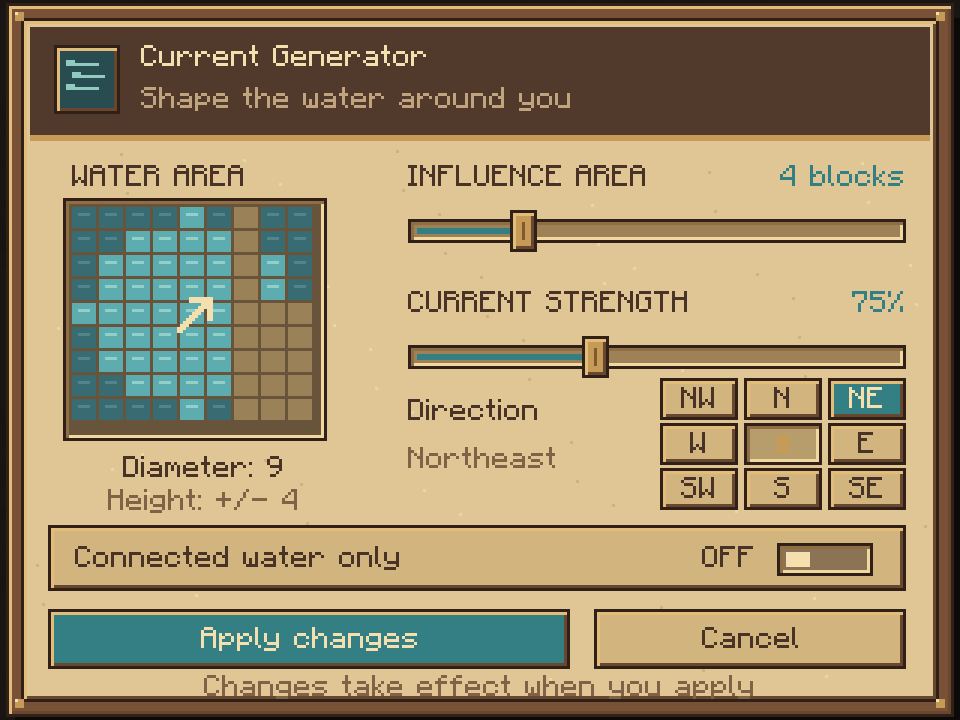

<h1 align="center">Flow Control</h1>

<a href="https://www.curseforge.com/minecraft/mc-mods/flow-control-streams-reflowing-addon">CurseForge</a> · <a href="https://github.com/Mikaaah/Streams-Flow-Control/wiki">Wiki</a> · <a href="https://github.com/Mikaaah/Streams-Flow-Control/issues">Report an issue</a> · <a href="https://github.com/Mikaaah/Streams-Flow-Control/blob/main/CHANGELOG.md">Changelog</a>

 

Shape currents and create calm water around docks, canals and builds. An addon for **Streams Reflowing**, available for NeoForge, Forge and Fabric.

## Versions and downloads

Version **0.1.5** includes the parchment controller GUI and an eight-way compass on all eight versions. Diagonal currents keep the selected speed, and controller arrows follow the chosen heading.

| Minecraft | Loader | Streams Reflowing | Java | Download |
| --- | --- | --- | --- | --- |
| 1.21.1 | NeoForge | 2.15.2 | 21 | [JAR](https://github.com/Mikaaah/Streams-Flow-Control/raw/refs/heads/main/downloads/flow-control-0.1.5-neoforge-1.21.1.jar) |
| 1.20.1 | Fabric | 2.15.2 | 17 | [JAR](https://github.com/Mikaaah/Streams-Flow-Control/raw/refs/heads/fabric/1.20.1/downloads/flow-control-0.1.5-fabric-1.20.1.jar) |
| 1.21.1 | Fabric | 2.15.2 | 21 | [JAR](https://github.com/Mikaaah/Streams-Flow-Control/raw/refs/heads/fabric/1.21.1/downloads/flow-control-0.1.5-fabric-1.21.1.jar) |
| 26.1.2 | Fabric | 2.15.2 | 25 | [JAR](https://github.com/Mikaaah/Streams-Flow-Control/raw/refs/heads/fabric/26.1.2/downloads/flow-control-0.1.5-fabric-26.1.2.jar) |
| 1.20.1 | Forge | 2.15.2 | 17 | [JAR](https://github.com/Mikaaah/Streams-Flow-Control/raw/refs/heads/forge/1.20.1/downloads/flow-control-0.1.5-forge-1.20.1.jar) |
| 1.21.11 | NeoForge | 2.15.2 | 21 | [JAR](https://github.com/Mikaaah/Streams-Flow-Control/raw/refs/heads/neoforge/1.21.11/downloads/flow-control-0.1.5-neoforge-1.21.11.jar) |
| 26.1.2 | NeoForge | 2.15.2 | 25 | [JAR](https://github.com/Mikaaah/Streams-Flow-Control/raw/refs/heads/neoforge/26.1.2/downloads/flow-control-0.1.5-neoforge-26.1.2.jar) |
| 26.3 | NeoForge | 2.15.2 | 25 | [JAR](https://github.com/Mikaaah/Streams-Flow-Control/raw/refs/heads/neoforge/26.3/downloads/flow-control-0.1.5-neoforge-26.3.jar) |

Install matching JARs on client and server. Fabric also requires Fabric API.
All eight builds and dedicated-server regression suites passed, including eight-way flow, equal diagonal speed, persistence and packet checks; the NeoForge 1.21.1 client was launched and all three controller-screen states were visually checked.

## Make water work for your build

| Item | What it does |
| --- | --- |
| **Flow Wand** | Direct flow, still water or restore natural flow in a chosen area. |
| **Current Generator** | Maintain a directional current; rotate its top arrow to steer the flow. |
| **Stillwater Anchor** | Calm currents around a dock or mooring. |

All three items have survival recipes. Right-click either controller to open its settings screen: adjust radius (with diameter and vertical reach), choose connected-water-only behavior, and set flow speed and direction on the Current Generator. Redstone power disables a controller. Break it to restore the underlying current.

## Install and start

Choose a matching Minecraft and loader build from the table above, then install this addon and **Streams Reflowing 2.15.2** on client and server. Use the Java version listed for that build; Fabric also requires Fabric API. **UltraTerraForged is not required.**

For a dock, place a Stillwater Anchor under or beside the water within four blocks of the boats. Right-click to adjust its radius; if there are multiple nearby ponds, enable *Connected water only*. Use the Flow Wand for temporary or shaped areas.

Flow changes velocity rather than moving water blocks or changing river terrain. Calm water removes current-induced drift; it does not prevent steering, collisions or momentum.

## Guides

[Items and controls](https://github.com/Mikaaah/Streams-Flow-Control/wiki/Items-and-Controls) · [Overlapping areas](https://github.com/Mikaaah/Streams-Flow-Control/wiki/Overlapping-Areas) · [Configuration](https://github.com/Mikaaah/Streams-Flow-Control/wiki/Configuration) · [Troubleshooting](https://github.com/Mikaaah/Streams-Flow-Control/wiki/Troubleshooting)

## Credits and license

By **Towns & Kingdoms**. [GPL-3.0-only](LICENSE). Requires Streams Reflowing; no dependency code or textures are redistributed.
